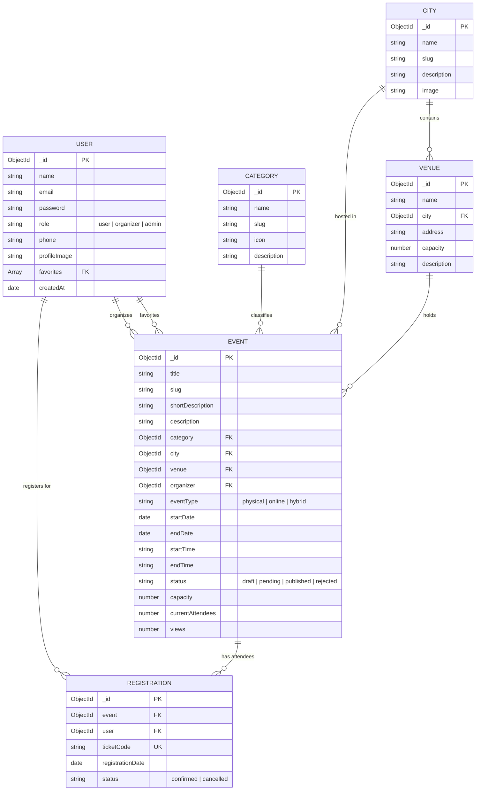
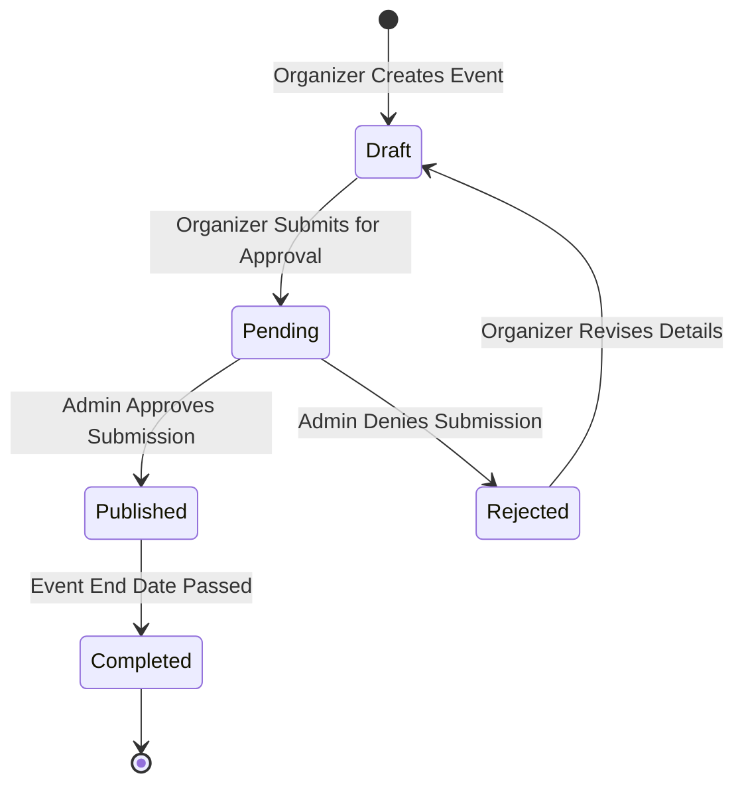
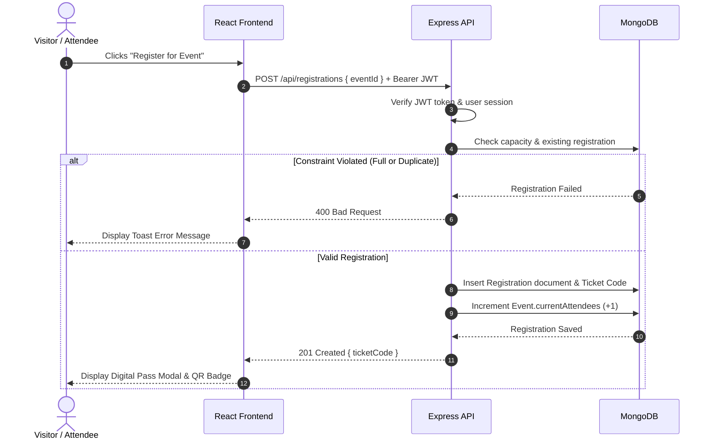

# EVENTORIA: The Event Hub of Algeria
## Final Year Project (PFE) Technical System Design & Architectural Report

---

## 1. Project Overview & Executive Summary

**EVENTORIA** is a centralized event discovery, publishing, and ticketing platform designed for the Algerian ecosystem (Technology bootcamps, university workshops, agricultural expos, trade fairs, and professional career days). It resolves the problem of scattered event announcements across unorganized social media pages and private channels.

### Key Technical Highlights
- **Tech Stack**: Full-Stack MERN (MongoDB, Express.js, React 19, Node.js)
- **Frontend Architecture**: Tailwind CSS v4, Lucide Icons, Glassmorphism design system, Recharts analytics
- **Security & RBAC**: Token-based authentication (JWT), bcrypt password hashing, and role-based access control (`user`, `organizer`, `admin`)
- **Containerization & Deployment**: Multi-container Docker compose configuration (MongoDB 6.0, Node.js REST API, Nginx / Vite SPA)

---

## 2. High-Level System Architecture Diagram


```mermaid
graph TD
    subgraph Client Layer [Frontend - React 19 + Tailwind v4]
        Visitor[Public Visitor]
        Organizer[Event Organizer]
        Admin[System Admin]
        ViteApp[React Single Page Application SPA]
        Visitor --> ViteApp
        Organizer --> ViteApp
        Admin --> ViteApp
    end

    subgraph Security & Routing Layer
        Axios[Axios API Client Interceptor]
        AuthGuard[JWT Auth Middleware]
        ViteApp --> Axios
        Axios --> AuthGuard
    end

    subgraph Application Server Layer [Backend - Express.js REST API]
        Express[Express Server Engine]
        AuthRoutes[/api/auth]
        EventRoutes[/api/events]
        RegRoutes[/api/registrations]
        AdminRoutes[/api/admin]

        AuthGuard --> Express
        Express --> AuthRoutes
        Express --> EventRoutes
        Express --> RegRoutes
        Express --> AdminRoutes
    end

    subgraph Database Layer [MongoDB NoSQL Database]
        Mongo[(MongoDB Database)]
        UserColl[(Users Collection)]
        EventColl[(Events Collection)]
        RegColl[(Registrations Collection)]
        CatColl[(Categories Collection)]
        CityColl[(Cities Collection)]
        VenueColl[(Venues Collection)]

        Express --> Mongo
        Mongo --> UserColl
        Mongo --> EventColl
        Mongo --> RegColl
        Mongo --> CatColl
        Mongo --> CityColl
        Mongo --> VenueColl
    end
```

---

## 3. Database Design & Entity-Relationship (ER) Diagram




---

## 4. Workflow & Sequence Diagrams


### 4.1 Event Submission & Admin Moderation Lifecycle



### 4.2 Ticket Registration Sequence



---

## 5. Security Architecture & Role Access Matrix

| System Endpoint / Resource | Visitor (Public) | Registered User | Organizer | Admin |
|---|:---:|:---:|:---:|:---:|
| `GET /api/events` (Discover) | ✅ | ✅ | ✅ | ✅ |
| `GET /api/categories`, `/api/cities` | ✅ | ✅ | ✅ | ✅ |
| `POST /api/auth/login` & `/register` | ✅ | ✅ | ✅ | ✅ |
| `POST /api/registrations` (Ticket Pass) | ❌ | ✅ | ✅ | ✅ |
| `GET /api/registrations/my-tickets` | ❌ | ✅ | ✅ | ✅ |
| `POST /api/events` (Create Event) | ❌ | ❌ | ✅ | ✅ |
| `GET /api/events/mine` | ❌ | ❌ | ✅ | ✅ |
| `PUT /api/admin/events/:id/status` | ❌ | ❌ | ❌ | ✅ |
| `POST /api/categories`, `/cities`, `/venues` | ❌ | ❌ | ❌ | ✅ |

---

## 6. Real Application Interface Screenshots

Authentic screenshots captured from live application routes:

- 🏠 **Public Homepage**: [docs/screenshots/home-page.png](file:///c:/Users/dell/Desktop/GomyCodeAcademy/eventhubPFE/docs/screenshots/home-page.png)
- 🔍 **Event Discovery Hub**: [docs/screenshots/discover-page.png](file:///c:/Users/dell/Desktop/GomyCodeAcademy/eventhubPFE/docs/screenshots/discover-page.png)
- 📄 **Event Details**: [docs/screenshots/event-details-page.png](file:///c:/Users/dell/Desktop/GomyCodeAcademy/eventhubPFE/docs/screenshots/event-details-page.png)
- 🔐 **Authentication Form**: [docs/screenshots/login-page.png](file:///c:/Users/dell/Desktop/GomyCodeAcademy/eventhubPFE/docs/screenshots/login-page.png)
- 🎟️ **User Dashboard & Pass**: [docs/screenshots/user-dashboard.png](file:///c:/Users/dell/Desktop/GomyCodeAcademy/eventhubPFE/docs/screenshots/user-dashboard.png)
- 📊 **Organizer Dashboard**: [docs/screenshots/organizer-dashboard.png](file:///c:/Users/dell/Desktop/GomyCodeAcademy/eventhubPFE/docs/screenshots/organizer-dashboard.png)
- ➕ **3-Step Event Creator**: [docs/screenshots/create-event-page.png](file:///c:/Users/dell/Desktop/GomyCodeAcademy/eventhubPFE/docs/screenshots/create-event-page.png)
- 🛡️ **Admin Moderation Queue**: [docs/screenshots/admin-dashboard.png](file:///c:/Users/dell/Desktop/GomyCodeAcademy/eventhubPFE/docs/screenshots/admin-dashboard.png)

---

## 7. Conclusion & PFE Defense Suitability

EVENTORIA provides a complete, production-grade Final Year Project (PFE) implementation. It delivers a modern visual presentation (Tailwind CSS v4 + Lucide icons + Recharts) backed by a clean, explainable MERN architecture suitable for academic defense.
