<div align="center">


<br><br>


<br>


<br><br>

**A centralized, cloud-ready event discovery, organization, and ticketing ecosystem tailored for Algeria. Built with the MERN stack featuring role-based workflows, real-time analytics, dynamic QR ticketing, and administrative event moderation.**

</div>

---

## 📑 Table of Contents

* [🚀 Live Production Demo](#-live-production-demo)
* [🌐 Platform Overview](#-platform-overview)
* [🎯 Project Vision & Problem Statement](#-project-vision--problem-statement)
* [✨ Key Features by Role](#-key-features-by-role)
* [🏗️ System Architecture](#️-system-architecture)
* [🗄️ Database Design (ER Schema)](#️-database-design-er-schema)
* [🔄 Lifecycle & Workflow Sequences](#-lifecycle--workflow-sequences)
* [🛠️ Technology Stack](#️-technology-stack)
* [📁 Repository Structure](#-repository-structure)
* [🔐 Security & Access Control](#-security--access-control)
* [🔑 Demo Credentials](#-demo-credentials)
* [📸 Application Screenshots](#-application-screenshots)
* [⚡ Quick Start & Local Setup](#-quick-start--local-setup)
* [🐳 Docker Deployment](#-docker-deployment)
* [🌐 Cloud Deployment Guide](#-cloud-deployment-guide)
* [📡 REST API Documentation](#-rest-api-documentation)
* [🧪 Testing & Quality Assurance](#-testing--quality-assurance)
* [🔮 Future Enhancements](#-future-enhancements)

---

# 🚀 Live Production Demo

The EVENTORIA platform is fully deployed and accessible on the cloud:

* **Production Web App**: 👉 **[https://eventhubpfe.vercel.app](https://eventhubpfe.vercel.app)**
* **Production REST API**: 👉 **[https://eventoria-api.onrender.com](https://eventoria-api.onrender.com)**
* **Database Layer**: MongoDB Atlas Cloud Cluster
* **🎥 Video Walkthrough**: [docs/video/eventoria_live_demo.webm](docs/video/eventoria_live_demo.webm) *(High-definition video tour of all workflows)*

---

# 🌐 Platform Overview

**EVENTORIA** is a comprehensive event management platform designed specifically for the Algerian ecosystem. Across Algerian cities (Algiers, Oran, Constantine, Sétif, Annaba), tech events, hackathons, academic seminars, professional summits, and cultural exhibitions have historically suffered from fragmented publication across disjointed social media channels.

EVENTORIA consolidates the entire lifecycle into an all-in-one web platform:

* 🔍 **Smart Discovery**: Real-time filtering by category, city, date, format (Physical, Online, Hybrid), and search keyword.
* 🎫 **Digital Ticketing**: Instant ticket generation with verifiable cryptographic alphanumeric codes and mock QR passes.
* 📊 **Organizer Hub**: Event publishing wizard, capacity tracker, attendee lists, and Recharts performance analytics.
* 🛡️ **Admin Moderation**: Rigorous review queue where system administrators verify and approve/reject event listings before they become public.
* 📱 **Modern Glassmorphic UI**: High-fidelity dark-themed interface built using Tailwind CSS v4, Lucide React icons, and fluid responsive layouts.

---

# 🎯 Project Vision & Problem Statement

### The Problem
- **Fragmented Visibility**: Algerian tech conferences, university seminars, and cultural festivals are scattered across Facebook groups, Instagram posts, and word-of-mouth.
- **Unreliable Attendance**: Organizers struggle to gauge actual interest without automated RSVP mechanisms and registration quotas.
- **Lack of Verification**: Fake or duplicate event posts erode trust without centralized administrative moderation.

### The Solution: The EVENTORIA Ecosystem
```text
  ┌────────────────┐       ┌────────────────┐       ┌────────────────┐
  │   ORGANIZER    │       │     ADMIN      │       │    ATTENDEE    │
  │                │       │                │       │                │
  │ • Draft Event  │       │ • Review Queue │       │ • Explore Hub  │
  │ • Submit Plan  ├──────►│ • Approve/Deny ├──────►│ • One-Click Reg│
  │ • View Metrics │       │ • Manage Enums │       │ • Get QR Pass  │
  └────────────────┘       └────────────────┘       └────────────────┘
```

---

# ✨ Key Features by Role

### 👤 1. Public Visitor & Registered Attendee
- **Rich Event Explorer**: Browse Algerian events with multi-criteria filters (Category, City, Format, Search Query).
- **Interactive Details**: Complete agenda, schedule, location map references, venue capacity bar, and organizer bios.
- **One-Click Registration**: Instant registration with automatic duplicate RSVP prevention and seat deduction.
- **Digital Pass Modal**: Dynamic ticket dialog presenting reference ID, QR code badge, date, venue, and status.
- **Attendee Dashboard**: Personal dashboard showing active tickets, event bookmarks, and historical passes.

### 🎪 2. Event Organizer
- **Multi-Step Creator Wizard**: Guided 3-step publishing flow (Basic details, Date & Venue configuration, Media & Capacity).
- **Interactive Dashboard**: Total events created, active attendees registered, total page views.
- **Weekly Analytics Graph**: Visual bar charts powered by **Recharts** detailing daily registrations.
- **Event Management Table**: View submission status (`draft`, `pending`, `published`, `rejected`), view attendee rosters, and edit details.

### 🛡️ 3. System Administrator
- **Moderation Queue**: Audit pending submissions submitted by organizers; accept or reject with one click.
- **Platform Analytics**: High-level counters for total users, published events, pending reviews, and global registrations.
- **Taxonomy Management**: CRUD management for Categories, Algerian Cities/Wilayas, and physical Venues.
- **User Governance**: View registered users across the platform with role tags and registration dates.

---

# 🔑 Demo Access Credentials

| Role | Email | Password | Dashboard Features |
|---|---|---|---|
| **Visitor / Attendee** | `user@eventoria.dz` | `user123` | Digital ticket passes, reference QR codes, saved favorites |
| **Event Organizer** | `organizer@eventoria.dz` | `organizer123` | Weekly view analytics graph, multi-step event creator wizard |
| **System Admin** | `admin@eventoria.dz` | `admin123` | Event moderation queue (Approve/Reject), category & venue CRUD |

---

# 🏗️ System Architecture

EVENTORIA adopts a decoupled **3-Tier Client-Server Architecture** designed for security, maintainability, and horizontal scalability:

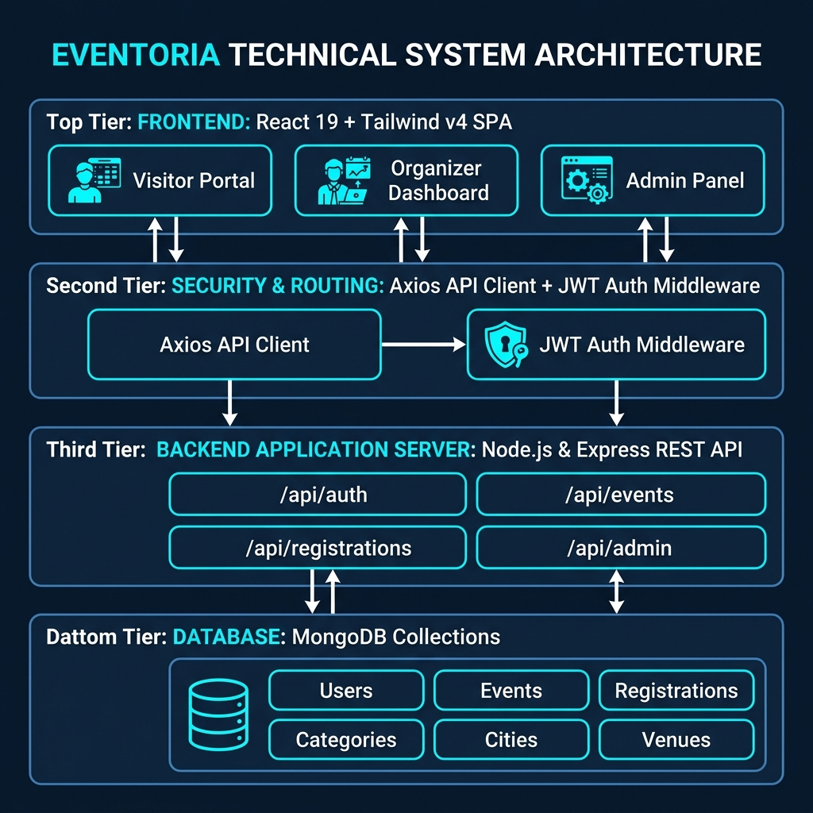

```text
                             ┌─────────────────────────┐
                             │       Web Clients       │
                             │ (Desktop, Tablet, Phone)│
                             └────────────┬────────────┘
                                          │
                                   HTTP/HTTPS (Port 3000)
                                          │
                                          ▼
                      ┌───────────────────────────────────────┐
                      │    Presentation Layer (Vite/React)    │
                      │                                       │
                      │ • React Router DOM v7 Routing         │
                      │ • AuthContext & Protected Routes      │
                      │ • Axios HTTP Client with JWT Header   │
                      │ • Tailwind CSS v4 & Lucide UI         │
                      │ • Recharts Data Visualizations        │
                      └───────────────────┬───────────────────┘
                                          │
                                    REST API / JSON
                                      (Port 5000)
                                          │
                                          ▼
                      ┌───────────────────────────────────────┐
                      │    Application Layer (Node/Express)   │
                      │                                       │
                      │ • Express Router & Route Modules      │
                      │ • JWT Authentication Middleware       │
                      │ • Role-Based Access Control (RBAC)    │
                      │ • CORS & Body Parsing Middleware      │
                      │ • Mongoose Schema Business Logic      │
                      └───────────────────┬───────────────────┘
                                          │
                                   MongoDB Native Driver
                                       (Port 27017)
                                          │
                                          ▼
                      ┌───────────────────────────────────────┐
                      │     Database Layer (MongoDB 6.0)      │
                      │                                       │
                      │ • Users Collection (Bcrypt Passwords) │
                      │ • Events Collection (Indexed by City) │
                      │ • Registrations (Unique Ticket Codes) │
                      │ • Categories, Cities & Venues         │
                      └───────────────────────────────────────┘
```

---

# 🗄️ Database Design (ER Schema)

The database schema is modeled with relational constraints in MongoDB using Mongoose references (`ObjectId`) and integrity indexes:

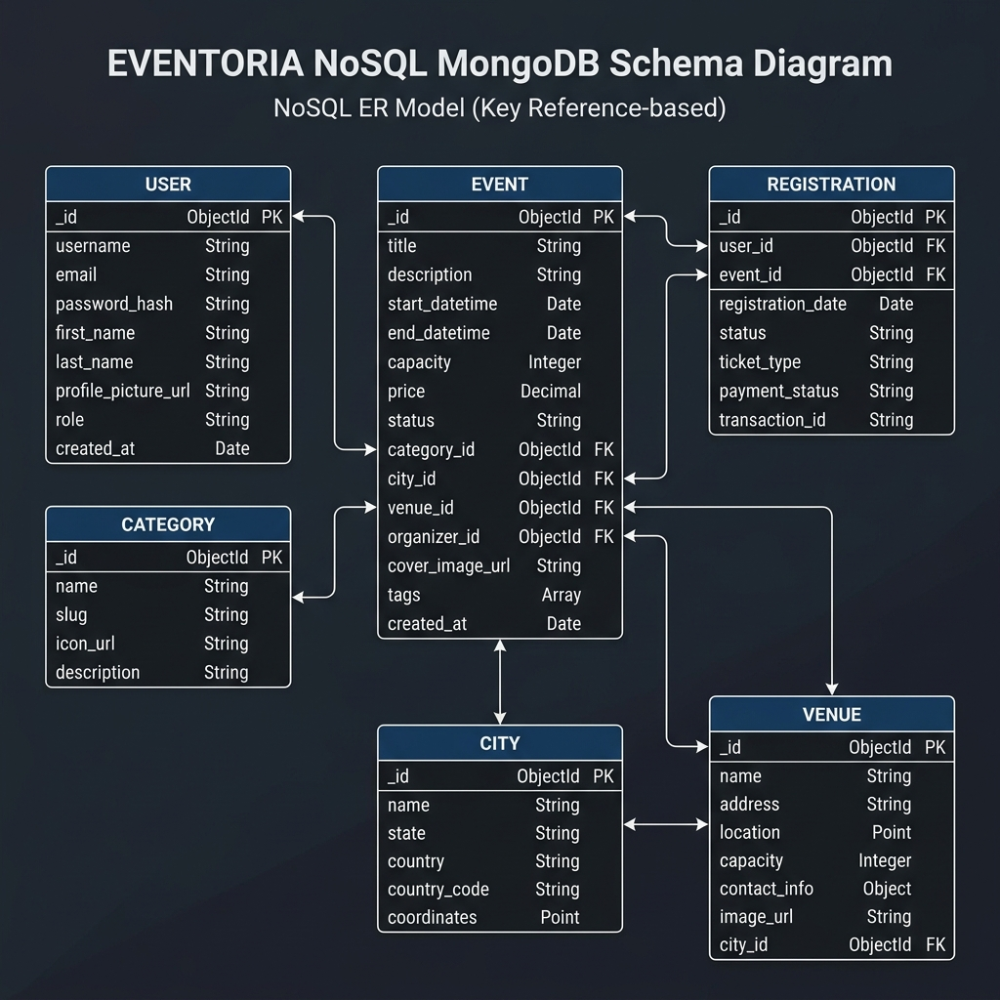

### Data Models & Collections:
* **User**: Manages credentials, contact info, profile image, array of favorite event IDs, and RBAC role (`user`, `organizer`, `admin`).
* **Category**: Classifies events (Technology, Culture, Business, Education, Sports) with icon indicators.
* **City**: Stores Algerian wilayas with city metadata and scenic banner images.
* **Venue**: Physical locations tied to a `City` with maximum seat capacities and exact addresses.
* **Event**: Primary entity linking `organizer` (User), `category`, `city`, and optional `venue`. Holds schedule timestamps, ticket pricing, published status, and view metrics.
* **Registration**: Connects an attendee `User` to an `Event`. Enforces unique compound indexing `(event, user)` to prohibit duplicate ticketing, and issues a cryptographic `ticketCode`.

---

# 🔄 Lifecycle & Workflow Sequences

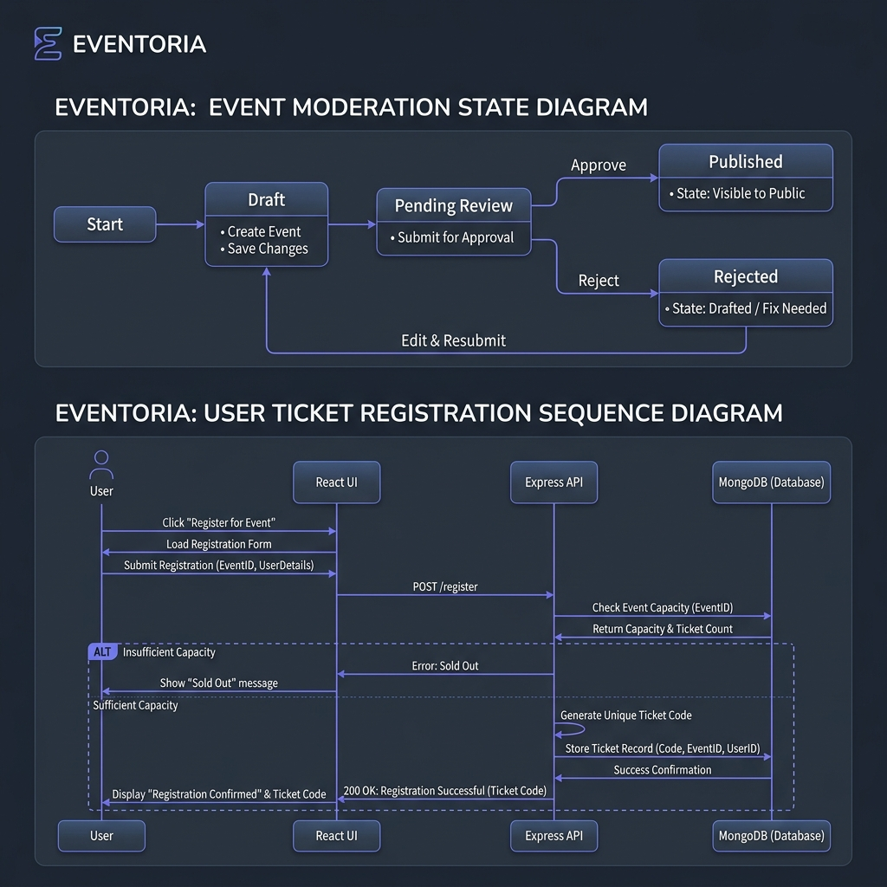

### 1. Event Moderation State Flow
```text
  [Organizer Creates] ──► (Draft) 
                              │
                              ▼
                         (Pending) ──[Admin Audits]
                              │
               ┌──────────────┴──────────────┐
               ▼                             ▼
          (Published)                   (Rejected)
               │                             │
               ▼                             ▼
        [Live to Public]              [Returned to Draft]
```

### 2. Ticket Registration Sequence
```text
User/Attendee                   React Frontend                 Express API               MongoDB
     │                                │                             │                       │
     │ 1. Click "Register for Event"  │                             │                       │
     ├───────────────────────────────►│                             │                       │
     │                                │ 2. POST /api/registrations  │                       │
     │                                │    + Bearer JWT             │                       │
     │                                ├────────────────────────────►│                       │
     │                                │                             │ 3. Check capacity     │
     │                                │                             │    & duplicate RSVP   │
     │                                │                             ├──────────────────────►│
     │                                │                             │ 4. Insert ticket doc  │
     │                                │                             │    & increment count  │
     │                                │                             │◄──────────────────────┤
     │                                │ 5. Return 201 Created       │                       │
     │                                │    { ticketCode, details }  │                       │
     │                                │◄────────────────────────────┤                       │
     │ 6. Display Digital Pass Modal  │                             │                       │
     │    with QR & Ticket Code       │                             │                       │
     │◄───────────────────────────────┤                             │                       │
```

---

# 🛠️ Technology Stack

| Layer | Technology | Version | Purpose |
|---|---|---|---|
| **Frontend Framework** | **React** | `19.0.0` | Declarative component UI architecture |
| **Build Tool** | **Vite** | `6.0.5` | Fast HMR dev server & optimized production rollup |
| **Styling** | **Tailwind CSS** | `v4.0.0` | Modern utility styling engine with CSS variables |
| **Routing** | **React Router DOM** | `7.1.1` | Client-side routing with layout wrappers & guards |
| **Icons** | **Lucide React** | `0.469.0` | Crisp vector icons for UI actions |
| **Data Visualization** | **Recharts** | `2.15.0` | Responsive SVG charts for organizer dashboards |
| **HTTP Client** | **Axios** | `1.7.9` | Promise-based HTTP client with request interceptors |
| **Backend Runtime** | **Node.js** | `>=18.x` | Asynchronous event-driven JavaScript engine |
| **Web Framework** | **Express.js** | `5.2.1` | High-performance RESTful API server |
| **Database** | **MongoDB** | `6.0` | Scalable NoSQL document store |
| **ODM** | **Mongoose** | `9.7.0` | Schema validation and relational aggregation |
| **Authentication** | **JWT (jsonwebtoken)**| `9.0.3` | Stateless token authentication |
| **Password Hashing**| **bcryptjs** | `3.0.3` | Salted credential hashing (10 rounds) |
| **Containerization**| **Docker & Compose** | `3.8` | Multi-service local and production containerization|

---

# 📁 Repository Structure

```text
eventhubPFE/
├── backend/                       # REST API & Business Logic
│   ├── config/
│   │   └── db.js                  # MongoDB Mongoose connection
│   ├── middleware/
│   │   └── auth.js                # JWT verification & role authorization (verifyToken, requireRole)
│   ├── models/
│   │   ├── User.js                # User identity & favorites
│   │   ├── Event.js               # Event metadata, status, & capacity
│   │   ├── Registration.js        # Ticket passes & verification codes
│   │   ├── Category.js            # Event categories
│   │   ├── City.js                # Algerian Wilayas
│   │   └── Venue.js               # Physical venues
│   ├── routes/
│   │   ├── auth.js                # /api/auth (register, login, profile)
│   │   ├── events.js              # /api/events (CRUD, discovery, filters)
│   │   ├── registrations.js       # /api/registrations (ticket generation & history)
│   │   ├── admin.js               # /api/admin (moderation queue & statistics)
│   │   ├── categories.js          # /api/categories
│   │   ├── cities.js              # /api/cities
│   │   └── venues.js              # /api/venues
│   ├── seed/
│   │   └── seeder.js              # Automated database population script
│   ├── server.js                  # Main server entry point
│   ├── Dockerfile                 # Backend container definition
│   └── package.json
│
├── frontend/                      # React 19 Client Application
│   ├── src/
│   │   ├── components/            # Reusable UI widgets
│   │   │   ├── Navbar.jsx         # Global navigation bar with role badges
│   │   │   ├── Footer.jsx         # Platform footer & links
│   │   │   ├── EventCard.jsx      # Discover grid item card
│   │   │   ├── ProtectedRoute.jsx # Route barrier requiring auth & specific role
│   │   │   ├── DashboardLayout.jsx# Sidebar layout for user/organizer/admin
│   │   │   └── TicketModal.jsx    # Pop-up digital ticket pass with QR code
│   │   ├── context/
│   │   │   └── AuthContext.jsx    # React Context for global auth state & tokens
│   │   ├── pages/
│   │   │   ├── Home.jsx           # Landing page with hero & featured events
│   │   │   ├── Discover.jsx       # Real-time search & multi-filter catalogue
│   │   │   ├── EventDetails.jsx   # Single event overview & registration CTA
│   │   │   ├── Login.jsx          # Login screen with instant demo credentials
│   │   │   ├── Register.jsx       # Attendee registration form
│   │   │   ├── user/
│   │   │   │   └── UserDashboard.jsx      # Ticket wallet & saved favorites
│   │   │   ├── organizer/
│   │   │   │   ├── OrganizerDashboard.jsx # Analytics & created events table
│   │   │   │   └── CreateEvent.jsx        # 3-step event submission wizard
│   │   │   └── admin/
│   │   │       └── AdminDashboard.jsx     # Moderation queue & system overview
│   │   ├── services/
│   │   │   └── api.js             # Central Axios instance with JWT interceptor
│   │   ├── App.jsx                # Route definitions
│   │   └── main.jsx               # Application DOM bootstrap
│   ├── public/                    # Static assets & SVG icons
│   ├── Dockerfile                 # Frontend multi-stage container
│   ├── vite.config.js             # Vite configuration with Tailwind v4
│   └── package.json
│
├── docs/                          # Architectural Specs & Diagrams
│   ├── system_architecture.png    # 3-Tier diagram graphic
│   ├── er_diagram.png             # Entity-relationship schema graphic
│   ├── event_lifecycle_workflow.png# Moderation & ticketing sequence graphic
│   ├── SYSTEM_ARCHITECTURE.md     # Architectural markdown spec
│   ├── ER_DIAGRAM.md              # Database schema markdown spec
│   ├── EVENT_LIFECYCLE_WORKFLOW.md# Workflows markdown spec
│   └── screenshots/               # Real application PNG captures
│       ├── home-page.png
│       ├── discover-page.png
│       ├── event-details-page.png
│       ├── login-page.png
│       ├── register-page.png
│       ├── user-dashboard.png
│       ├── organizer-dashboard.png
│       ├── create-event-page.png
│       └── admin-dashboard.png
│
├── docker-compose.yml             # Orchestration for Mongo + API + Client
├── DEPLOYMENT.md                  # Comprehensive setup & cloud deployment guide
├── Eventoria_Project_Report.md    # Complete academic PFE defense document
└── README.md                      # Primary project documentation
```

---

# 🔐 Security & Access Control

EVENTORIA adheres to core application security principles:

### 1. Role-Based Access Control (RBAC) Matrix
| Route / Capability | Visitor (Public) | Registered User | Organizer | System Admin |
|---|:---:|:---:|:---:|:---:|
| Browse & Discover Events | ✅ | ✅ | ✅ | ✅ |
| View Event Details | ✅ | ✅ | ✅ | ✅ |
| Account Authentication (Login/Register) | ✅ | ✅ | ✅ | ✅ |
| Reserve Event Tickets | ❌ | ✅ | ✅ | ✅ |
| Access Ticket Wallet (`/dashboard/user`) | ❌ | ✅ | ✅ | ✅ |
| Submit New Events (`/dashboard/organizer/create`) | ❌ | ❌ | ✅ | ✅ |
| View Organizer Metrics & Analytics | ❌ | ❌ | ✅ | ✅ |
| Access Admin Moderation (`/dashboard/admin`) | ❌ | ❌ | ❌ | ✅ |
| Approve / Reject Pending Events | ❌ | ❌ | ❌ | ✅ |
| Manage Categories, Cities, & Venues | ❌ | ❌ | ❌ | ✅ |

### 2. Additional Security Controls
- **Password Salting & Hashing**: All passwords run through `bcryptjs` with 10 salt rounds before storage; plain passwords are never saved.
- **JWT Authentication**: Secured Bearer tokens carry encrypted user IDs and roles, verified on protected API routes via middleware.
- **Client Route Guards**: React Router protected routes prevent unauthorized client URL tampering.
- **Input Sanitization**: Email addresses are converted to normalized lowercase; inputs are strictly validated prior to Mongoose writes.
- **Preventing Duplicate Registrations**: Unique database compound indexing `(event, user)` strictly guarantees attendees cannot double-book.

---

# 📸 Application Screenshots

High-resolution captures from the running application:

### 🏠 Public Landing Page
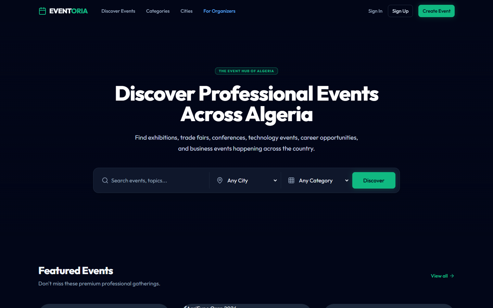

### 🔍 Event Discovery Hub
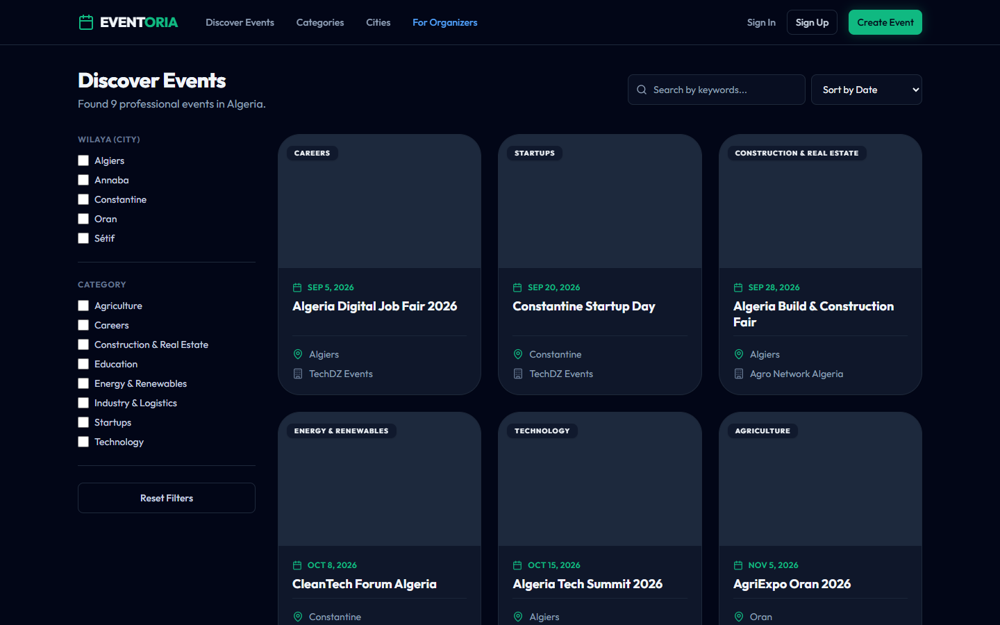

### 📄 Event Details & Registration
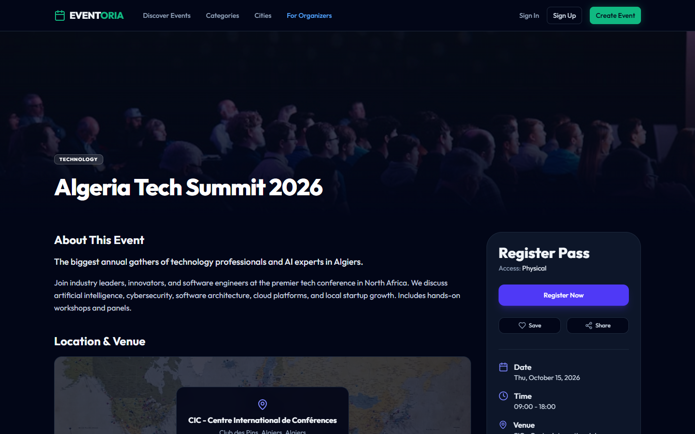

### 🔐 Authentication Portal
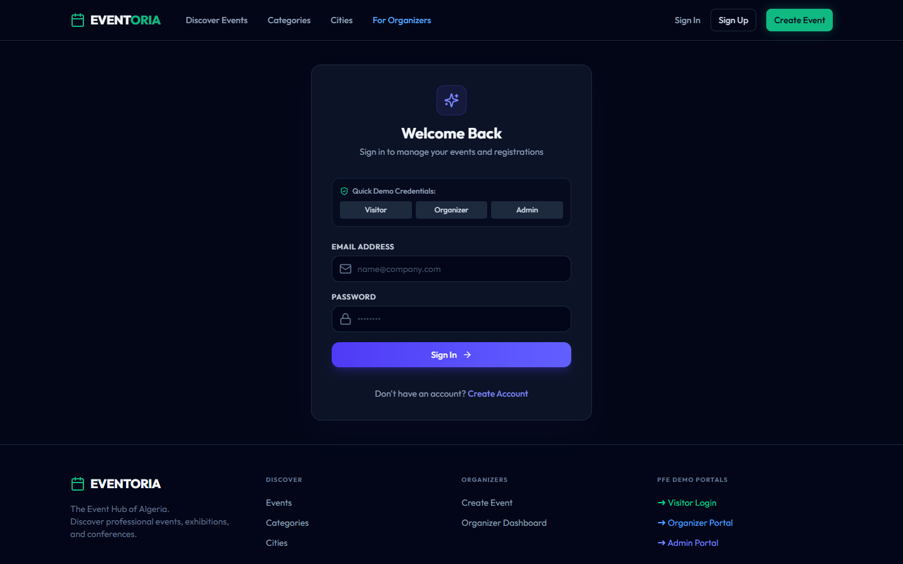

### 🎟️ Attendee Dashboard & Digital Ticket Pass
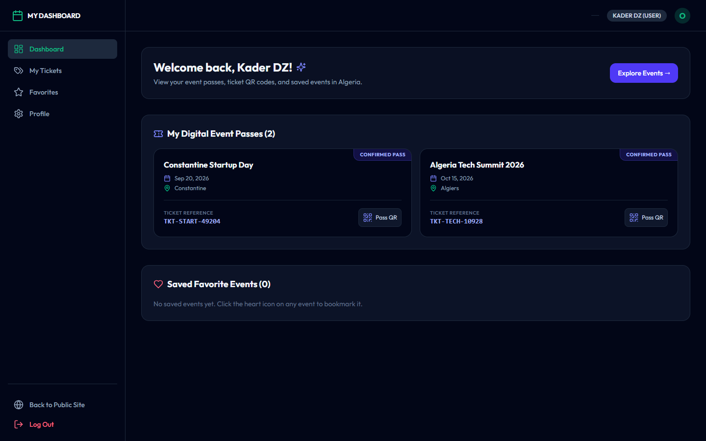

### 📊 Organizer Analytics Dashboard
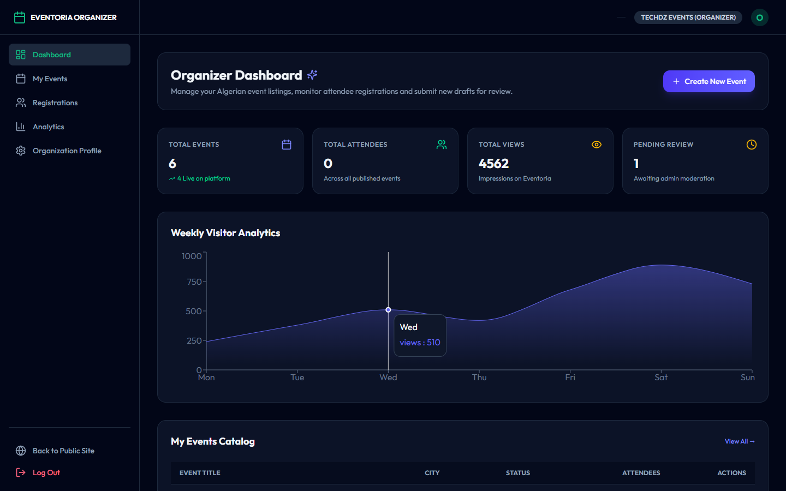

### ➕ 3-Step Event Publishing Wizard
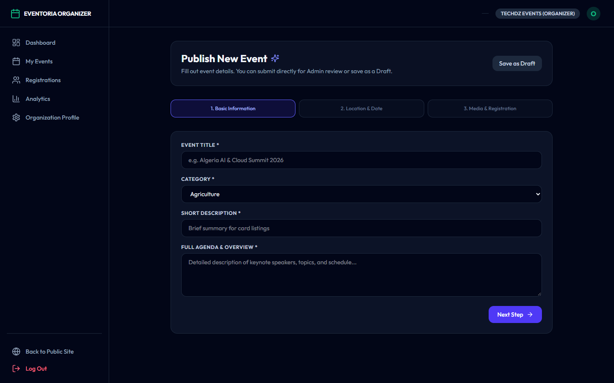

### 🛡️ System Admin Moderation Panel
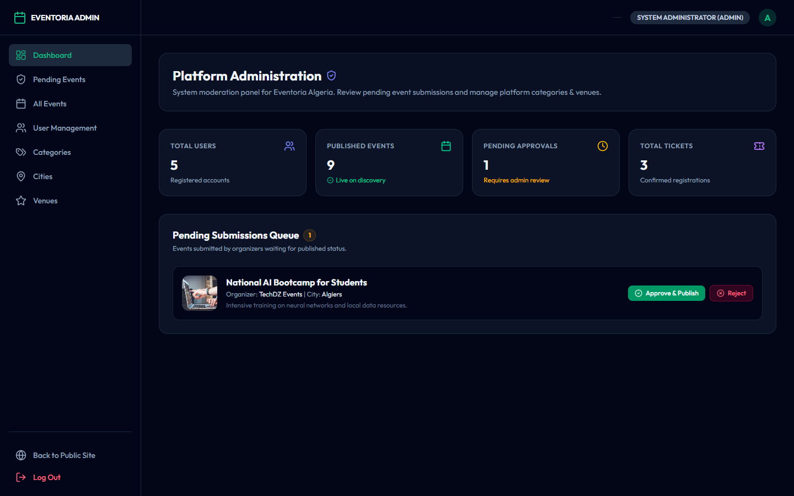

---

# ⚡ Quick Start & Local Setup

### Prerequisites
- [Node.js](https://nodejs.org/) (v18.x or v20.x recommended)
- [MongoDB](https://www.mongodb.com/) (Local service on port 27017 or a free MongoDB Atlas connection string)
- [Git](https://git-scm.com/)

### Step 1: Clone the Repository
```bash
git clone https://github.com/DZ-Kader/eventhub_cloudbasedsystem.git
cd eventhub_cloudbasedsystem
```

### Step 2: Configure Environment Variables
Create a `.env` file in the `backend/` directory:
```env
PORT=5000
MONGO_URI=mongodb://localhost:27017/eventoria
JWT_SECRET=eventoria_jwt_pfe_secret_key_2025
CLIENT_URL=http://localhost:3000
```

*(Optional)* Create a `.env` file in the `frontend/` directory:
```env
VITE_API_URL=http://localhost:5000/api
```

### Step 3: Install Dependencies
```bash
# Root scripts automatically route into submodules
npm install
cd backend && npm install
cd ../frontend && npm install
cd ..
```

### Step 4: Seed Initial Algerian Data
Populates categories, wilayas (Algiers, Oran, Constantine, etc.), venues, sample events, and demo accounts:
```bash
npm run seed
```

### Step 5: Start the Development Servers
Open two terminal windows:
```bash
# Terminal 1: Launch Backend REST API (Port 5000)
npm run dev:backend

# Terminal 2: Launch Frontend Client (Port 3000)
npm run dev:frontend
```
Open **[http://localhost:3000](http://localhost:3000)** in your browser.

---

# 🐳 Docker Deployment

The entire stack can be launched without manual runtime installations using Docker Compose:

```bash
# Build and start all services in detached mode
docker-compose up --build -d
```

### Running Containers:
- **Frontend SPA**: `http://localhost:3000`
- **Backend API**: `http://localhost:5000`
- **MongoDB**: `localhost:27017`

To inspect container logs:
```bash
docker-compose logs -f backend
```

To shut down containers:
```bash
docker-compose down
```

---

# 🌐 Cloud Deployment Guide

### Database (MongoDB Atlas)
1. Deploy a free M0 cluster on [MongoDB Atlas](https://www.mongodb.com/cloud/atlas).
2. Under Network Access, allow access from anywhere (`0.0.0.0/0`).
3. Under Database Access, create a user and obtain your connection URI:
   `mongodb+srv://<username>:<password>@cluster0.mongodb.net/eventoria?retryWrites=true&w=majority`

### Backend Service (Render / Railway / Koyeb)
1. Link your repository and set the root directory to `backend/`.
2. Set Environment Variables:
   - `MONGO_URI`: Atlas connection string
   - `JWT_SECRET`: Secure cryptographic string
   - `NODE_ENV`: `production`
   - `CLIENT_URL`: Your deployed frontend URL
3. Build Command: `npm install`
4. Start Command: `node server.js`

### Frontend Application (Vercel / Netlify)
1. Link your repository and set the root directory to `frontend/`.
2. Build Command: `npm run build`
3. Output Directory: `dist`
4. Set Environment Variable:
   - `VITE_API_URL`: `https://your-backend-api.onrender.com/api`

---

# 📡 REST API Documentation

### Authentication Endpoints (`/api/auth`)
| Method | Endpoint | Description | Auth Required |
|---|---|---|:---:|
| `POST` | `/api/auth/register` | Register new user account | No |
| `POST` | `/api/auth/login` | Authenticate and issue JWT token | No |
| `GET` | `/api/auth/profile` | Retrieve authenticated user profile | Yes |
| `PUT` | `/api/auth/profile` | Update profile information | Yes |

### Events Endpoints (`/api/events`)
| Method | Endpoint | Description | Auth Required |
|---|---|---|:---:|
| `GET` | `/api/events` | List published events (supports query filters) | No |
| `GET` | `/api/events/:id` | Get full details of a specific event | No |
| `POST` | `/api/events` | Create a new event draft / submit for review | Yes (Organizer/Admin) |
| `PUT` | `/api/events/:id` | Update an existing event | Yes (Organizer/Admin) |
| `DELETE`| `/api/events/:id` | Remove an event | Yes (Organizer/Admin) |
| `GET` | `/api/events/mine` | List all events created by logged-in organizer | Yes (Organizer/Admin) |

### Registrations & Ticketing (`/api/registrations`)
| Method | Endpoint | Description | Auth Required |
|---|---|---|:---:|
| `POST` | `/api/registrations` | Register for an event and receive ticket pass | Yes |
| `GET` | `/api/registrations/my-tickets`| View all active and past tickets for the user | Yes |
| `DELETE`| `/api/registrations/:id`| Cancel registration and release reserved seat | Yes |

### Administration Endpoints (`/api/admin`)
| Method | Endpoint | Description | Auth Required |
|---|---|---|:---:|
| `GET` | `/api/admin/events` | List all events across all statuses | Yes (Admin) |
| `PUT` | `/api/admin/events/:id/status`| Moderate event (`published` / `rejected`) | Yes (Admin) |
| `GET` | `/api/admin/stats` | Retrieve global system counts and activity | Yes (Admin) |

---

# 🧪 Testing & Quality Assurance

To ensure system reliability, the platform was verified across multiple vectors:

- **E2E Authentication Test**: Verified that unauthenticated users are blocked from protected routes and redirected to `/login`.
- **Registration Integrity**: Tested that multiple consecutive clicks on "Register" do not duplicate ticket passes.
- **Seat Counter Integrity**: Verified that event `currentAttendees` increments upon confirmed registration and decrements on cancellation.
- **Moderation Verification**: Confirmed that events submitted by organizers remain invisible on `/discover` until approved by an administrator.
- **Frontend Build**: Verified with Vite production bundling:
  ```bash
  npm run build:frontend
  ```

---

# 🔮 Future Enhancements

Potential roadmap items for post-graduation iteration:
- [ ] **Algiers Postal/Satim Payment Gateway**: Integration with CIB / Edahabia for paid event ticketing.
- [ ] **Email & SMS Notifications**: Automatic PDF ticket delivery via Nodemailer upon registration.
- [ ] **Real-Time Check-In Scanner**: Mobile camera QR barcode scanning for on-site event staff.
- [ ] **Interactive Venue Seating**: Visual seat picker for auditoriums and conference halls.
- [ ] **Multilingual Support**: Arabic, French, and English localization.

---

